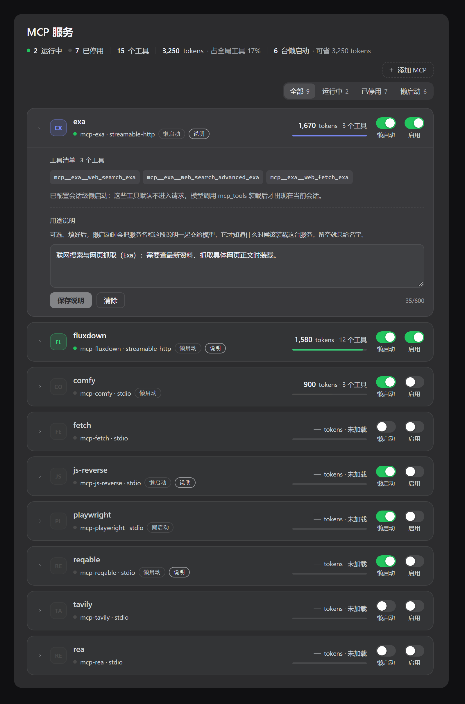

# dsh-mcp-manage

给 **DeepSeek Harness**（DSH）用的 MCP 管理插件：
把一堆 MCP 服务器收进设置面板「**MCP管理**」，一台服务器一行，能看占用、能一键启停，
并且可以按服务器开启**会话级懒启动**——真正省下那些常驻在每次请求里的工具 token。

> 实测：本机 9 台 MCP、54 个工具，全部常驻时约 17,900 tokens；只留两台（15 个工具）约 3,250 tokens。
> 其中 ComfyUI 一家 39 个工具就占 14,700 tokens，而绝大多数对话根本用不到它。



## 它解决什么问题

MCP 工具的 JSON Schema 会跟着每一次请求发给模型。服务器装得越多，常驻成本越高，
而模型多数时候根本不会调用它们。本插件提供三层控制：

| 控制层 | 粒度 | 效果 | 存在哪 |
|---|---|---|---|
| **启用开关** | 每台服务器 / 全局 | 整台装或卸：断开连接、注销工具、移除提示段 | `pluginManager`（profile/.plugin-manager） |
| **懒启动开关** | 每台服务器 / **每会话生效** | 工具照常注册，但默认不进请求，模型调 `mcp_tools` 装载后才可见 | profile 的 `cordis.patch.yml` 本行 `config.lazyServers` |
| **用途说明** | 每台服务器 | 可选，一句话说明这台是干什么的；懒启动时随名字一起交给模型 | 同上，`config.serverNotes` |

## 特色：会话级懒启动

```
面板打开某台的懒启动  →  config.lazyServers: [comfy]
新会话的每次请求      →  system-prompt/assemble 瀑布里按会话过滤
                      →  mcp__comfy__* 全部剔除，只留一个装载器 mcp_tools
装载器描述            →  "Lazy servers: comfy — 本地出图流水线，画图/改图时装载"
模型调 mcp_tools      →  { servers: ["comfy"] }
下一步                →  comfy 的 39 个工具出现，本会话后续请求都可见
```

- **只影响当前会话**：A 会话装了 comfy，B 会话仍然看不到；子代理各自独立。
- **下一步生效**：工具块每次请求重装配，装载后下一轮即可调用（宿主自带 tool-addition 通知）。
- **只列已启用的**：描述和目录里只出现「懒启动 **且** 已启用」的服务器，不会骗模型去装一个空壳。
- **描述实时刷新**：面板上开/关任意一行后，装载器描述立即跟着变，不需要重载插件。
- **可选用途说明**：留空就只给名字；写了就一起注入，模型才知道**什么时候**该装这台。

没有开启任何懒启动时，插件不注册 `mcp_tools`，工具块与你没装本插件时完全一致。

## 安装

要求：DSH 0.4+（用到 `settings.section` 面板槽与 `system-prompt/assemble` 装配瀑布）。

```powershell
# 1. 放进任意目录，然后在你的 profile 里安装
dsh plugin --profile desktop add D:\path\to\dsh-mcp-manage

# 2. 或者直接从 GitHub 装
dsh plugin --profile desktop add https://github.com/hisence999/dsh-mcp-manage
```

安装完成后插件是**空的**：面板会显示 0 台服务，因为仓库里带的 `cordis.patch.yml`
只挂载插件自己（没有服务器、没有密钥）。往里加服务器有三种方式，任选：

| 方式 | 适合谁 |
| --- | --- |
| 面板顶部「**+ 添加 MCP**」 | 最省事，有选项式表单和 JSON 粘贴两种填法，写完即生效 |
| 复制 `cordis.patch.example.yml` 改成 `cordis.patch.yml` | 想一次配很多台、或想用 `!!js process.env.XXX` 引环境变量 |
| 手写 `- insert:` 行 | 熟悉 Loader patch 语法的人 |

或者手工挂载（开发时用）：

```powershell
# profile 目录下
npm pkg set "dependencies.dsh-mcp-manage=link:D:/path/to/dsh-mcp-manage"
npm pkg set "dsh.profile.bundles[]=dsh-mcp-manage"   # 追加到 bundles 数组
# 建软链/junction 让 Loader 能解析包名
New-Item -ItemType Junction -Path node_modules\dsh-mcp-manage -Target D:\path\to\dsh-mcp-manage
```

然后重启宿主（或触发一次配置重组）。设置 → 侧栏出现「**MCP管理**」（order 18）即成功。

### MCP 配置

MCP 服务器全部写在 `cordis.patch.yml` 的 `- insert:` 列表里，**一台一行**：

```yaml
- insert:
    - id: mcp-manage                 # 插件自己那一行，别删
      name: 'dsh-mcp-manage'

    - id: mcp-exa
      name: '@deepseek-ai/dsh-mcp-client'
      config:
        serverName: exa
        transport: streamable-http
        url: https://mcp.exa.ai/mcp
        headers:
          x-api-key: !!js process.env.EXA_API_KEY
```

两条不能违反的规矩：

1. **文件必须是顶层 YAML 数组**。0 字节、只有注释、或者不是数组，宿主会
   直接拒绝并**静默跳过整个 bundle**（插件根本不挂载，也不好排查）。
2. **新行只能写在 `- insert:` 里**。同级的 `- id: xxx` 只能*覆盖*已经存在的行，
   覆盖不存在的 id 会被丢弃。

仓库里带的是最小可用配置（只挂 `mcp-manage` 自己），完整字段模板见
[`cordis.patch.example.yml`](cordis.patch.example.yml)。

改完配置不会自动热更：重启宿主，或随便改一下 profile 的 `cordis.patch.yml` 触发重组。
（用面板「+ 添加 MCP」则无需重启，插件会自动重组。）

## 使用

面板一台服务器一张卡片：

- 左侧：展开箭头 + 首字母徽标 + 服务名，下面是状态点、`mcp-<名字> · 传输方式`，以及「懒启动」「说明」两个小标签；
- 右侧：`tokens · N 个工具` 与一条占用条（相对占比，过小或无工具时显示 `—`）；
- 最右：**懒启动**、**启用** 两个开关，标题写在开关下方。

点卡片展开：这台服务器的工具清单、懒启动提示，以及「用途说明」编辑框（`保存说明` / `清除` / 字数计数）。

- **tokens** 按工具 schema 序列化后的字符数 ÷ 4 粗估，与宿主 `tokenMeter` 的口径不同，只用来看相对大小。
- **状态点**只表示插件是否加载，不代表 MCP 连接可用；`failOnStartupError: false` 时连接失败不会弹错。
- 点「说明」标签就知道这台写过描述；`保存说明` 写回 profile，`清除` 置空。
- 顶部统计行可点：`全部 / 运行中 / 已停用 / 懒启动` 四档筛选，右侧显示懒启动可省下的 token。

### 在面板里添加 MCP

右上角「**+ 添加 MCP**」直接在面板里加一台服务器，两种填法：

- **选项式**：名称 + 传输方式（本地进程 stdio / 远程 HTTP）+ 启动命令 / 启动参数 / 环境变量，或 URL / 请求头。
- **JSON**：粘贴 `{"mcpServers": {…}}` 标准写法，可以一次加多台；`command` 视为 stdio，`url` 视为 http。
  与你从 Trae / Claude 等编辑器里复制出来的配置同构。

```json
{
  "mcpServers": {
    "github": {
      "command": "npx",
      "args": ["-y", "@modelcontextprotocol/server-github"],
      "env": { "GITHUB_TOKEN": "…" }
    }
  }
}
```

写入过程与报错都按「失败就不动文件」设计：先在内存里校验（名称合法性、`command` 不能带空格、
url 协议、同名重复……），再追加一段 `- insert:` 到 profile 的 `cordis.patch.yml` 并原子替换，
最后让 Loader 重组；重组失败会**自动回滚**并把宿主给的失败原因原样返回。
写进去的是纯文本块，文件里其它行一个字节都不动（不会重排注释、也不会改写你手写的 `!!js` 表达式）。

页面对应的 Host 路由（挂在 `/mcp-manage/api`）：

| 路由 | 作用 |
|---|---|
| `GET /state` | 所有服务器 + 汇总（工具数 / tokens / 懒启动可省 / 已写说明数） |
| `POST /toggle` | `{ id, enabled }`，整台启停 |
| `POST /lazy` | `{ server, lazy }`，写回 `config.lazyServers` |
| `POST /note` | `{ server, note }`，写回 `config.serverNotes`（≥600 字报 400，`""` 即清除） |
| `POST /add` | `{ mode:'json', json }` 或 `{ mode:'form', server, config }`，新增一台或多台服务器 |

## 边界

- 懒启动只裁剪**请求里的工具块**（省 token），不阻止模型凭记忆直接调用已注册的工具；
  要硬隔离得另加 `tools.guard`。
- PTC（code-mode）模式下工具块里只有 `run_code`，该机制不生效（默认 native 模式下正常）。
- 用途说明属于「提示」不是「约束」：模型看到说明只是更可能选对服务器，装载决策仍归它自己。
- 写法基于现有插件管理器 / 装配瀑布 API 的组合，非官方文档化用法，DSH 大版本升级后可能需要适配。

## 维护者笔记：为什么仓库里的 `cordis.patch.yml` 是空配置

插件作者自己那份 `cordis.patch.yml` 里有一堆真实 API key，不能推到远端；
但这个文件又**必须存在**（宿主读 bundle 的 patch 走的是「必需文件」路径，
缺了会把整个 bundle 丢进 `skippedBundles`，装上去等于没装）。

所以做法是让「磁盘上的文件」和「git 索引里的文件」是两份：

```
磁盘 cordis.patch.yml   = 你的完整配置（含密钥），永不提交
索引 cordis.patch.yml   = 仓库里的最小配置（只挂 mcp-manage 自己，可以公开）
```

这靠 git 的 `skip-worktree` 标志位实现，本地完全无感（`git status` 永远干净）：

```powershell
git ls-files -v cordis.patch.yml          # 大写 S = 已锁定
git update-index --no-skip-worktree cordis.patch.yml   # 要改它时先解锁
git update-index --skip-worktree    cordis.patch.yml   # 改完再锁回去
```

⚠️ 解锁期间**不要提交**，否则你的密钥就进去了。

`git pull` 若报 `Your local changes ... would be overwritten` / `not uptodate`：

```powershell
git update-index --no-skip-worktree cordis.patch.yml
git checkout -- cordis.patch.yml                 # 先退回最小版
Copy-Item cordis.patch.local.yml cordis.patch.yml  # 用你自己的备份盖回去
git update-index --skip-worktree cordis.patch.yml
```

（`cordis.patch.local.yml` 也在 `.gitignore` 里，专门放这份备份。）

### 发布前必读：`npm pack` 会绕过 skip-worktree

`skip-worktree` 只挡 git，**挡不住打包工具**。在插件目录里直接 `npm pack`
（或任何读磁盘的打包器）会把磁盘上那份**含真实密钥**的 `cordis.patch.yml`
打进 tarball。发布 / 打包前务必从干净的 clone 或 `git archive` 出来的目录里做：

```powershell
git archive --format=tar HEAD | tar -x -C ..\dsh-mcp-manage-release
cd ..\dsh-mcp-manage-release
npm pack
```

用 `git archive` 拿到的永远是仓库里的最小配置，从根上避免这个问题。

## License

[MIT](LICENSE)
